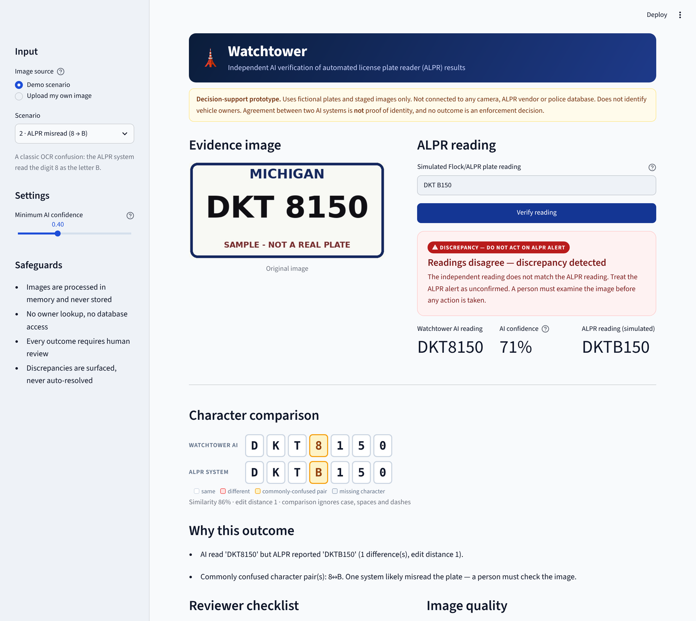

# 🗼 Watchtower

**Independent AI verification for automated license plate reader (ALPR) results.**

Watchtower is a proof-of-concept built for a Michigan AI hackathon. It takes a photo of a
vehicle or license plate together with the plate number an ALPR system (such as a
Flock Safety camera) *claims* it saw, reads the plate again with an independent,
open-source OCR model, and flags any discrepancy for a human reviewer.



> **Decision support only.** Watchtower uses fictional plates and staged images. It is not
> connected to any camera, ALPR vendor, or police database, does not identify vehicle
> owners or people, and never makes an enforcement decision. Agreement between two AI
> systems is **not** proof of identity.

---

## The problem

ALPR cameras read plates automatically and compare them against "hot lists". OCR is
imperfect: `8` becomes `B`, `0` becomes `O`, digits get transposed, and snow, glare,
motion blur, or a dirty plate can turn a guess into a confident-looking "hit". When an
automated hit is acted on without anyone checking the underlying image, a single
misread character can lead to a wrongful, sometimes dangerous, police stop of an
innocent driver.

## The solution

Watchtower adds an **independent second read plus a mandatory human checkpoint**:

1. A reviewer uploads the image behind an ALPR alert and enters the ALPR's reading.
2. Watchtower reads the plate itself with EasyOCR, a different model from the vendor's.
3. A comparison engine aligns the two readings character by character and highlights
   every difference. It also flags differences that are known OCR confusions (8↔B, 0↔O…).
4. The result is one of three outcomes. **Every one of them routes to a human.**

| Outcome | Meaning | What the reviewer is told |
|---|---|---|
| **Readings agree — human verification still required** | Both systems produced the same characters | Two machines agreeing is not proof. Compare the image and the vehicle details yourself. |
| **Readings disagree — discrepancy detected** | The independent reading differs from the ALPR reading | Treat the ALPR alert as unconfirmed. Examine the image before any action. |
| **Image unreadable — inconclusive, manual review required** | No plate text found, or AI confidence below the threshold | The ALPR reading cannot be corroborated by this tool. Review manually. |

### Step 2: alert corroboration checks

A correct plate read only answers "what characters are on this plate?". Wrongful stops
also happen when the hot-list entry is stale, when the car doesn't match the description,
or when nobody actually confirmed anything. After the plate verification, Watchtower runs
three automated checks against **fictional incident records** (`data/incidents.json`):

| Check | Met when | Not met when |
|---|---|---|
| **Suspect plate is known** | An *active* record lists the ALPR plate **and** the independent reading agrees | No record, the record is `cleared` (stale alert), or the independent reading differs (a misread that happens to hit a listed plate). *Needs review* if the image was unreadable. |
| **Distinctive vehicle features match** | At least 2 observed features (color, make, model, distinctive marks) match the record, and none contradict it | Any observed feature contradicts the record. *Needs review* if too little is visible. |
| **Independent corroboration documented** | An independent method is logged, with a reviewer ID and a note of at least 20 characters | Nothing logged, or only "ALPR alert only" / "Watchtower AI agreement". Automated systems cannot corroborate themselves. |

Any check that is not met gives an overall **"Do not act on this alert"**. Even when all
three are met, the result is only **"ready for a human decision"**. Watchtower never
authorizes a stop, and the exported record always has `"authorizes_action": false`.
The fictional records contain plate, vehicle description and a fictional reason only:
no owner names, addresses or other personal data.

---

## Quick start (local)

Requirements: **Python 3.10 – 3.13**, about 2–3 GB of free disk for PyTorch, and an
internet connection the first time you run it (EasyOCR downloads its model weights,
about 100 MB, to `~/.EasyOCR/`).

```bash
git clone <your-repo-url> watchtower
cd watchtower
python -m venv .venv
source .venv/bin/activate          # Windows: .venv\Scripts\activate
pip install -r requirements.txt
python scripts/make_samples.py     # (re)generates the fictional demo images in samples/
streamlit run app.py
```

Then open <http://localhost:8501>.

* **Demo mode:** pick one of five staged scenarios in the sidebar and press **Verify reading**.
* **Your own image:** choose *Upload my own image*, add a JPEG/PNG/BMP/WEBP of a
  **fictional or staged** plate (max 10 MB), type the simulated ALPR reading, and verify.
* The first verification takes longer while the model loads. After that, each check
  takes roughly 1–5 s on a laptop CPU.
* Optional: set `WATCHTOWER_MODEL_DIR=/some/path` to store the EasyOCR weights elsewhere.
* Tip: on machines without an NVIDIA GPU you can install the much smaller CPU-only
  PyTorch first:
  `pip install torch torchvision --index-url https://download.pytorch.org/whl/cpu`

### Demo scenarios

| # | Image (fictional) | Simulated ALPR reading | Plate outcome | Corroboration checks (plate · features · corroboration) |
|---|---|---|---|---|
| 1 | `BXR 4827`, clear | `BXR 4827` | Agree (human verification still required) | Met · Met · Not met until you fill in the corroboration log, then **all met** |
| 2 | `DKT 8150`, clear | `DKT B150` | Disagree, with 8↔B flagged as commonly confused | Not met (misread hits a listed plate) · Not met · Not met |
| 3 | `HWN 3392`, clear | `HWN 3329` | Disagree (transposed digits) | Not met · Not met (one feature matches, color doesn't) · Not met |
| 4 | `CPL 6604`, night blur | `CPL 6604` | Inconclusive | Needs review · Needs review · Not met |
| 5 | `ELM 2045`, staged vehicle photo | `ELM 2045` | Agree | Met · **Not met (record says blue, car is red)** · Not met |

Each scenario pre-fills staged "reviewer observations" of the vehicle. You can edit them,
and the checks update immediately. A plate the records list as `cleared` (`MTL 7731`)
shows how stale alerts are caught.

## Running the tests

```bash
pytest                       # everything (68 tests, ~15 s once the model is cached)
pytest -m "not integration"  # fast unit tests only; no OCR model needed (~5 s)
pytest -m integration        # end-to-end with real EasyOCR on the demo images
```

| Test file | Covers |
|---|---|
| `tests/test_compare.py` | normalization, confusable pairs, edit distance, substitutions, insertions, deletions, transpositions |
| `tests/test_imaging.py` | empty/corrupt/truncated/oversized/tiny/unsupported uploads, RGBA and grayscale handling, quality warnings |
| `tests/test_ocr_and_verify.py` | plate-text selection heuristics, second-pass OCR, all three outcomes, confidence threshold, input validation (uses a fake OCR backend) |
| `tests/test_integration_easyocr.py` | the five demo scenarios end-to-end with the real model |
| `tests/test_checks.py` | record loading and validation, all three corroboration checks, overall summary never authorizes action |
| `tests/test_app_smoke.py` | the Streamlit page renders, demo pre-fills, Verify is disabled without an image |

---

## How it works

```
 upload ──► imaging.load_image ──► ocr.PlateReader.read ──► verify.verify ──► Streamlit UI
            validate, EXIF-rotate,  EasyOCR pass 1           confidence gate     verdict card
            RGB, downscale          (retry on enhanced       compare.compare_    highlighted diff
            + quality metrics        image if confidence     readings            reviewer checklist
                                     is low)                                      JSON review record
```

### Project structure

```
watchtower/
├── app.py                         # Streamlit UI only; no decision logic
├── watchtower/
│   ├── plate_text.py              # normalization, plate length rules, OCR-confusable pairs
│   ├── imaging.py                 # safe loading, quality metrics, OCR enhancement, box drawing
│   ├── ocr.py                     # EasyOCR backend + pure "which text is the plate?" selection
│   ├── compare.py                 # alignment, edit distance, highlighted segments
│   ├── verify.py                  # the three-outcome decision + JSON review record
│   └── checks.py                  # step 2: plate-known / features / corroboration checks
├── data/incidents.json            # FICTIONAL incident records (no personal data)
├── scripts/make_samples.py        # generates the fictional demo images
├── samples/                       # staged demo images ("SAMPLE - NOT A REAL PLATE")
├── tests/
├── .streamlit/config.toml         # theme, 10 MB upload limit, telemetry off
└── requirements.txt
```

### Key design decisions

* **The UI holds no logic.** Everything that decides an outcome is plain Python in the
  `watchtower` package, so it can be unit-tested without a browser or an OCR model.
* **OCR behind a one-function interface.** `PlateReader` takes any `backend(image) -> detections`
  callable. Tests use a fake. Swapping in a different engine (PaddleOCR, a plate-specific
  model) does not touch the comparison or decision code.
* **Picking the plate text.** EasyOCR returns every piece of text it finds ("MICHIGAN",
  slogans, sticker dates, frame text). Watchtower drops known non-registration words, joins
  boxes on the same line (`BXR` + `4827`), keeps strings of plausible plate length (2–8),
  and picks the line with the tallest characters.
* **Two-pass OCR.** If the first read is below 60% confidence, the image is converted to
  grayscale, upscaled, denoised and contrast-equalized (CLAHE), then read again. The better
  of the two passes wins.
* **Confidence gate.** An independent reading below the threshold (default 40%, adjustable
  in the sidebar) is **inconclusive**. A low-confidence read is never used to confirm *or*
  dispute an ALPR hit, even if its characters happen to match.
* **Normalization.** Comparison ignores case, spaces and dashes (`abc-1234` = `ABC 1234`).
* **Diff alignment.** Equal-length readings are compared position by position, the way a
  person checks a plate, so swapped digits show up as two substitutions. Readings of
  different lengths use sequence alignment, so a dropped character shows as a gap instead
  of every later character being marked wrong.
* **Confusable pairs explain differences but never excuse them.** `8↔B` is still a
  *disagreement*. The note only helps the reviewer see which system probably slipped.
* **Privacy by default.** Images are processed in memory and never written to disk. The
  downloadable review record contains readings and scores only, with no image and no
  personal data.

---

## Limitations

Be honest about these when presenting:

* **General-purpose OCR, not a plate model.** EasyOCR was not trained specifically on
  license plates. Commercial ALPR systems use specialized models, infrared cameras, and
  multi-frame capture. Watchtower is a *second opinion*, not a better first opinion.
* **Plate-selection heuristics can be fooled.** Large text elsewhere in a scene (a
  dealership decal, a bumper sticker, a sign) may be read instead of the plate. Cropped
  plate images work best, and the technical-details panel shows exactly which region was used.
* **No state, plate-type, or vehicle verification.** Watchtower compares characters only.
  The same characters on plates from different states are different vehicles, and a
  correct plate read says nothing about who is driving.
* **Confidence scores are not calibrated probabilities.** "95%" is the model's internal
  score, not a 95% chance of being right. Thresholds were chosen on staged images and
  would need validation on representative, consented data.
* **Shared failure modes.** Two OCR systems can make the *same* mistake on the same blurry
  image. That is why agreement still requires human verification.
* **Synthetic demo data.** The demo images are rendered with Pillow, so real-world accuracy
  will be lower, especially for night, snow, glare, angled, or partially covered plates.
* **Feature matching is only as good as the observations.** Color names are subjective
  ("silver" vs "gray"), and make/model are typed by the reviewer, not detected from the
  image. The check catches contradictions; it can't prove a match.
* **Simulated ALPR input.** The ALPR reading is typed by the user. There is no integration
  with any vendor, by design.
* **CPU performance.** Roughly 1–5 s per image on a laptop. That is fine for a review
  workflow but not for real-time video.

## How Watchtower could benefit Michigan communities

* **Fewer wrongful stops.** An independent check plus a mandatory human review step
  catches misreads before an officer acts on them. That protects drivers and also protects
  officers from walking into a high-risk stop of an innocent person.
* **Michigan conditions.** Lake-effect snow, road salt and slush, long winter nights, and
  the state's many standard and specialty plate designs all make automated reads harder.
  A second read that says "inconclusive" out loud is valuable exactly then.
* **Oversight for local governments.** City councils, township boards, and civilian
  oversight commissions deciding whether to adopt or renew ALPR contracts could use a tool
  like this to audit a sample of alerts and measure how often automated reads hold up.
* **Fairness in court.** Public defenders and legal-aid clinics could independently check
  the image behind an ALPR-initiated stop instead of relying solely on the vendor's output.
* **Transparency and trust.** Open-source code, explainable outputs (highlighted
  characters, confidence, image-quality warnings), and an exportable review record make
  automated policing decisions easier for residents to understand and question.
* **Education and research.** Michigan universities and community colleges could use it to
  teach responsible AI: why model agreement is not ground truth, and how to keep a human
  accountable for consequential decisions.

### Possible next steps

* Benchmark on a consented, representative dataset and publish error rates by condition
  (night, snow, angle).
* Add a plate-detection model to crop the plate before OCR, and compare against several
  independent OCR engines.
* Batch audit mode: upload a folder of past alerts (with images) and produce aggregate
  discrepancy statistics for oversight bodies.
* Accessibility review and Spanish and Arabic UI translations for Michigan communities.

## Responsible-use constraints (built into this prototype)

* Fictional plates and staged images only. Demo plates are labelled "SAMPLE - NOT A REAL PLATE".
* No connection to real cameras, ALPR vendors, police systems, or registration databases.
* No owner lookup and no identification of individuals.
* No automated enforcement decision. Every outcome requires human review.
* Agreement between two AI systems is presented as *agreement*, never as identity proof.

## Tech stack

Python · Streamlit · EasyOCR (PyTorch) · OpenCV · Pillow · NumPy · pytest. All open source.
